# نقشهٔ دادهٔ پنل نگین میثاق (Facility)

همهٔ 18 جدول سرویس Facility (اسکیمای `panel`) با 159 فیلد و 28 کلید خارجی؛ ساخته‌شده مستقیم از مدل EF.
نسخهٔ HTML همین سند: [`Facility-ER.html`](Facility-ER.html). تولید دوباره: `dotnet run --project facilityservice/tools/FacilityErDoc` (تست `FacilityErDocumentTests` کهنه بودنش را می‌گیرد).

**قراردادها:** مبلغ‌ها ریال؛ تاریخ‌ها میلادی ذخیره و شمسی نمایش؛ نرخ و درصد به درصد (۴ یعنی ۴٪). ستون‌های Registrar / By / EditedBy عکس فوری کاربر در لحظهٔ عملیات‌اند (JSON). توضیح هر جدول و ستون در SQL Server هم ثبت شده است (MS_Description).

## نمودار کامل (ER)

```mermaid
erDiagram
  Schemes ||--o| SchemeSettings : "SchemeId"
  SchemeSettings ||--o{ SchemePlans : "SchemeId"
  Files |o--o{ Companies : "AgreementFileId"
  Schemes ||--o{ Companies : "SchemeId"
  Companies ||--o{ CompanyPlans : "CompanyId"
  SchemePlans ||--o{ CompanyPlans : "PlanId"
  Companies ||--o{ MonthlyBalances : "CompanyId"
  Companies ||--o| CompanyCancellations : "CompanyId"
  Files ||--o{ CompanyCancellations : "LetterFileId"
  Reasons ||--o{ CompanyCancellations : "ReasonId"
  Companies ||--o{ BalanceDocuments : "CompanyId"
  Reasons ||--o{ BalanceDocuments : "DocumentTypeId"
  Files ||--o{ BalanceDocuments : "FileId"
  Companies ||--o{ Personnel : "CompanyId"
  Files |o--o{ Personnel : "DeleteFileId"
  PersonnelImports |o--o{ Personnel : "ImportBatchId"
  Personnel ||--o{ PersonnelHistory : "PersonnelId"
  Companies ||--o{ PersonnelImports : "CompanyId"
  Companies ||--o{ LoanBatches : "CompanyId"
  SchemePlans ||--o{ LoanBatches : "PlanId"
  LoanBatches ||--o{ LoanRequests : "BatchId"
  Companies ||--o{ LoanRequests : "CompanyId"
  Personnel ||--o{ LoanRequests : "PersonnelId"
  SchemePlans ||--o{ LoanRequests : "PlanId"
  LoanRequests ||--o{ LoanRequestHistory : "RequestId"
  Files ||--o{ LoanRequestDocuments : "FileId"
  LoanRequests ||--o{ LoanRequestDocuments : "RequestId"
  Companies |o--o{ ChangeLogs : "CompanyId"
  Schemes {
    int Id PK "شناسهٔ طرح (Identity)"
    string Code UK "کد یکتا؛ مثلاً NEGIN"
    string Title "نام طرح"
    bool IsActive "فعال/غیرفعال"
  }
  SchemeSettings {
    int SchemeId PK,FK "شناسهٔ طرح (۱ به ۱ با Schemes)"
    string ContractTypes "انواع عقد مجاز، JSON: [1,2]"
    decimal QardHasanRate "نرخ قرض‌الحسنه (درصد) — bQarz؛ روی همهٔ طرح‌ها…"
    string MurabahaRates "نرخ‌های مرابحه، JSON: [5,10,15,20,23]"
    string RepaymentTermsMonths "مدت‌های بازپرداخت (ماه)، JSON"
    decimal SalaryFromSepahMultiplierYes "ضریب دریافت حقوق از سپه — بله (۱٫۱)"
    decimal SalaryFromSepahMultiplierNo "ضریب دریافت حقوق از سپه — خیر (۱)"
    int ContractDurationMonths "مدت قرارداد (ماه، ۱ تا ۱۲۰)"
    int GraceMonthsAfterExpiry "مهلت استفاده از مانده پس از انقضا (ماه)"
    int MaxPlansPerCompany "حداکثر طرح قابل انتخاب برای هر شرکت (۱ تا ۱۰)"
    int PersonnelIntroductionDelayMonths "مهلت مجاز شدن معرفی پرسنل پس از انعقاد (ماه)"
    int WaitingPeriodDays "دورهٔ انتظار معرفی به بانک (روز)"
    bool DigitalApprovalEnabled "مرحلهٔ تأیید شعبهٔ دیجیتال فعال است؟"
    int Version "نسخهٔ همزمانی؛ با هر تغییر +۱ (در API: rowVers…"
  }
  SchemePlans {
    int Id PK "شناسهٔ طرح؛ بعد از ویرایش اطلاعات پایه ثابت می…"
    int SchemeId FK,UK "طرح کلان"
    byte ContractType UK "۱ قرض‌الحسنه، ۲ مرابحه"
    decimal Rate UK "نرخ (درصد)"
    int TermMonths UK "مدت بازپرداخت (ماه)"
    decimal UsablePercent "درصد قابل استفاده از مجموع میانگین"
    bool IsActive "ردیف حذف‌شده از جدول غیرفعال می‌شود، نه پاک"
  }
  Companies {
    long Id PK "شناسهٔ شرکت (در Identity = ScopeId دامنهٔ شرکت)"
    int SchemeId FK "طرح کلان"
    string Name "نام شرکت (فارسی، ۳ تا ۱۰۰)"
    string NationalId "شناسهٔ ملی ۱۱ رقمی؛ بین شرکت‌های حذف‌نشده یکتا"
    string AgreementNumber "شمارهٔ تفاهم‌نامه"
    string AccountNumber "شمارهٔ حساب جاری (۸ تا ۲۴ رقم)"
    date ContractDate "تاریخ انعقاد قرارداد"
    date AccountOpeningDate "افتتاح حساب سپرده؛ روزِ ماهش = روز مجاز انتقال…"
    bool SalaryFromSepah "حقوق پرسنل از بانک سپه؟"
    string BranchCode "شعبهٔ شرکت (دامنهٔ کاربر شعبه)"
    byte Status "۱ فعال، ۲ لغو قرارداد، ۳ منقضی، ۴ حذف‌شده"
    string Registrar "عکس فوری کاربر (JSON): شناسه، نام، کد کاربر، ن…"
    datetime CreatedAt "زمان ثبت"
    long AgreementFileId FK "فایل تفاهم‌نامه"
    datetime DeletedAt "زمان حذف نرم"
    string DeleteDescription "توضیح حذف"
    int BalancesVersion "نسخهٔ جدای جدول میانگین‌ها"
    int Version "نسخهٔ همزمانی؛ با هر تغییر +۱ (در API: rowVers…"
  }
  CompanyPlans {
    long CompanyId PK,FK "شرکت"
    int PlanId PK,FK "طرح"
  }
  MonthlyBalances {
    long CompanyId PK,FK "شرکت"
    string Month PK "ماه شمسی، مثل 1405/07"
    long Amount "میانگین موجودی (ریال)"
    string EditedBy "عکس فوری کاربر (JSON): شناسه، نام، کد کاربر، ن…"
    datetime EditedAt "زمان ثبت/ویرایش"
  }
  CompanyCancellations {
    long CompanyId PK,FK "شرکت (۱ به ۰..۱)"
    date CancelDate "تاریخ لغو (۱۴۰۵/۰۱/۰۱ تا امروز)"
    int ReasonId FK "دلیل از فهرست (نوع ۱)"
    string ReasonTitle "عنوان دلیل در لحظهٔ لغو"
    string Description "توضیح (۵ تا ۱۰۰۰)"
    long LetterFileId FK "فایل نامهٔ لغو (الزامی)"
    string CancelledBy "عکس فوری کاربر (JSON): شناسه، نام، کد کاربر، ن…"
    datetime CancelledAt "زمان ثبت لغو"
  }
  BalanceDocuments {
    long Id PK "شناسه"
    long CompanyId FK "شرکت"
    string Month "ماه مربوط (اختیاری)"
    int DocumentTypeId FK "نوع مستند (دلیل نوع ۶: بنکو، نامه، …)"
    string Description "توضیح"
    long FileId FK "فایل"
  }
  Personnel {
    long Id PK "شناسه"
    long CompanyId FK "شرکت"
    int Priority "اولویت تخصیص (۱ تا ۹۹۹)"
    string FullName "نام و نام خانوادگی"
    string NationalCode "کد ملی؛ در هر شرکت یکتا"
    string Mobile "موبایل (۰۹…)"
    string PersonnelCode "کد پرسنلی"
    date HireDate "تاریخ استخدام (آینده ممنوع)"
    byte Status "۱ در انتظار مدیر، ۲ تأییدشده، ۳ ردشده، ۴ حذف‌شده"
    string RejectReason "علت رد"
    datetime CreatedAt "زمان معرفی"
    datetime DecidedAt "زمان تصمیم مدیر"
    string Registrar "عکس فوری کاربر (JSON): شناسه، نام، کد کاربر، ن…"
    long ImportBatchId FK "اگر از فایل اکسل آمده"
    string DeleteDescription "توضیح حذف"
    long DeleteFileId FK "فایل مستند حذف"
    int Version "نسخهٔ همزمانی؛ با هر تغییر +۱ (در API: rowVers…"
  }
  PersonnelHistory {
    long Id PK "شناسه"
    long PersonnelId FK "پرسنل"
    byte From "وضعیت قبلی"
    byte To "وضعیت جدید"
    string Reason "دلیل"
    string Description "توضیح"
    string By "عکس فوری کاربر (JSON): شناسه، نام، کد کاربر، ن…"
    datetime At "زمان"
  }
  PersonnelImports {
    long Id PK "شناسه"
    long CompanyId FK "شرکت"
    string FileName "نام فایل"
    int TotalRows "تعداد ردیف"
    int Accepted "ثبت‌شده"
    int Rejected "ردشده"
    string ErrorsJson "خطای هر ردیف: [{row, column, message}]"
    string Registrar "عکس فوری کاربر (JSON): شناسه، نام، کد کاربر، ن…"
    datetime CreatedAt "زمان"
  }
  LoanBatches {
    long Id PK "شناسهٔ ثبت"
    long CompanyId FK "شرکت"
    int PlanId FK "طرح"
    byte Mode "۱ مبلغ یکسان، ۲ مبلغ جدا برای هر نفر"
    date BaseDate "تاریخ مبنا (فقط یک ماه گذشته)"
    string Description "توضیح"
    string Registrar "عکس فوری کاربر (JSON): شناسه، نام، کد کاربر، ن…"
    datetime CreatedAt "زمان ثبت"
    string BranchCode "کپی شعبهٔ شرکت"
  }
  LoanRequests {
    long Id PK "شناسهٔ درخواست"
    long BatchId FK "ثبت"
    long CompanyId FK "شرکت (کپی از ثبت)"
    string BranchCode "کپی شعبهٔ شرکت، برای فیلتر دامنه بدون Join"
    long PersonnelId FK "پرسنل"
    int PlanId FK "طرح (کپی از ثبت)"
    long Amount "مبلغ (۱۰ میلیون تا ۴ میلیارد ریال)"
    int PaymentOrder "ترتیب پرداخت (پیش‌فرض اولویت پرسنل)"
    datetime CreatedAt "زمان ثبت"
    datetime DecidedAt "زمان آخرین تصمیم"
    byte Status "۱ انتظار مدیر، ۲ رد مدیر، ۳ انتظار اعتبارات، ۴…"
    byte PostStage "پس از تأیید: ۱ تشکیل پرونده، ۲ دریافت از امید …"
    string Description "دلیل و توضیح رد/لغو"
    string Registrar "عکس فوری کاربر (JSON): شناسه، نام، کد کاربر، ن…"
    int Version "نسخهٔ همزمانی؛ با هر تغییر +۱ (در API: rowVers…"
  }
  LoanRequestHistory {
    long Id PK "شناسه"
    long RequestId FK "درخواست"
    byte From "وضعیت قبلی"
    byte To "وضعیت جدید"
    byte Stage "مرحلهٔ پس از تأیید (اگر تغییر مرحله بوده)"
    string Reason "دلیل"
    string Description "توضیح"
    string By "عکس فوری کاربر (JSON): شناسه، نام، کد کاربر، ن…"
    datetime At "زمان"
  }
  LoanRequestDocuments {
    long RequestId PK,FK "درخواست"
    long FileId PK,FK "فایل (یک فایل می‌تواند پیوست چند درخواست گروهی…"
  }
  Reasons {
    int Id PK "شناسه"
    byte Type "۱ لغو قرارداد، ۲ رد وام، ۳ عدم اعطای غیرحضوری،…"
    string Title "عنوان"
    bool IsActive "فعال"
    int SortOrder "ترتیب نمایش"
  }
  Files {
    long Id PK "شناسه"
    string FileName "نام اصلی"
    string ContentType "نوع فایل"
    long Size "حجم (بایت)"
    string StorageKey "کلید Minio: facility-panel/yyyy/MM/…"
    datetime UploadedAt "زمان بارگذاری"
    string UploadedBy "بارگذارکننده"
  }
  ChangeLogs {
    long Id PK "شناسه"
    datetime At "زمان"
    int UserId "کاربر پنل در Identity (بدون FK؛ سرویس دیگر)"
    string User "عکس فوری کاربر (JSON): شناسه، نام، کد کاربر، ن…"
    byte Category "۱ شرکت، ۲ پرسنل، ۳ وام، ۴ کاربر"
    string Action "عملیات"
    string Details "جزئیات"
    string Before "مقدار قبلی (JSON)"
    string After "مقدار جدید (JSON)"
    long CompanyId FK "شرکت؛ null = تغییر اطلاعات پایه"
    string BranchCode "شعبهٔ شرکت (فیلتر دامنه)"
    string RestoreKind "balances یا personnel-delete"
    string RestorePayload "دادهٔ لازم برای بازگردانی"
    datetime RestoredAt "زمان بازگردانی"
  }
```

## اطلاعات پایه

صفحهٔ اول نمونهٔ پنل

### `Schemes` — طرح کلان

نگین میثاق، شجره طیبه، هم‌پیمان، …

| فیلد | نوع SQL | کلید | Null | توضیح |
|---|---|---|---|---|
| `Id` | `int` | PK |  | شناسهٔ طرح (Identity) |
| `Code` | `nvarchar(30)` | UK |  | کد یکتا؛ مثلاً NEGIN |
| `Title` | `nvarchar(100)` |  |  | نام طرح |
| `IsActive` | `bit` |  |  | فعال/غیرفعال |

**ارجاع‌دهنده:** `SchemeSettings`، `Companies`

### `SchemeSettings` — اطلاعات پایهٔ طرح

همان فرم صفحهٔ اول نمونه (دکمهٔ «ذخیره تنظیمات پایه»)

| فیلد | نوع SQL | کلید | Null | توضیح |
|---|---|---|---|---|
| `SchemeId` | `int` | PK, FK |  | شناسهٔ طرح (۱ به ۱ با Schemes) |
| `ContractTypes` | `varchar(50)` |  |  | انواع عقد مجاز، JSON: [1,2] |
| `QardHasanRate` | `decimal(5,2)` |  |  | نرخ قرض‌الحسنه (درصد) — bQarz؛ روی همهٔ طرح‌های قرض‌الحسنه |
| `MurabahaRates` | `varchar(200)` |  |  | نرخ‌های مرابحه، JSON: [5,10,15,20,23] |
| `RepaymentTermsMonths` | `varchar(200)` |  |  | مدت‌های بازپرداخت (ماه)، JSON |
| `SalaryFromSepahMultiplierYes` | `decimal(5,2)` |  |  | ضریب دریافت حقوق از سپه — بله (۱٫۱) |
| `SalaryFromSepahMultiplierNo` | `decimal(5,2)` |  |  | ضریب دریافت حقوق از سپه — خیر (۱) |
| `ContractDurationMonths` | `int` |  |  | مدت قرارداد (ماه، ۱ تا ۱۲۰) |
| `GraceMonthsAfterExpiry` | `int` |  |  | مهلت استفاده از مانده پس از انقضا (ماه) |
| `MaxPlansPerCompany` | `int` |  |  | حداکثر طرح قابل انتخاب برای هر شرکت (۱ تا ۱۰) |
| `PersonnelIntroductionDelayMonths` | `int` |  |  | مهلت مجاز شدن معرفی پرسنل پس از انعقاد (ماه) |
| `WaitingPeriodDays` | `int` |  |  | دورهٔ انتظار معرفی به بانک (روز) |
| `DigitalApprovalEnabled` | `bit` |  |  | مرحلهٔ تأیید شعبهٔ دیجیتال فعال است؟ |
| `Version` | `int` |  |  | نسخهٔ همزمانی؛ با هر تغییر +۱ (در API: rowVersion) |

**مرجع:** `SchemeId` → `Schemes`

**ارجاع‌دهنده:** `SchemePlans`

### `SchemePlans` — طرح قابل انتخاب

هر ردیف «جدول درصد قابل استفاده»؛ ۳۰ طرح در نمونه

| فیلد | نوع SQL | کلید | Null | توضیح |
|---|---|---|---|---|
| `Id` | `int` | PK |  | شناسهٔ طرح؛ بعد از ویرایش اطلاعات پایه ثابت می‌ماند |
| `SchemeId` | `int` | FK, UK |  | طرح کلان |
| `ContractType` | `tinyint` | UK |  | ۱ قرض‌الحسنه، ۲ مرابحه |
| `Rate` | `decimal(5,2)` | UK |  | نرخ (درصد) |
| `TermMonths` | `int` | UK |  | مدت بازپرداخت (ماه) |
| `UsablePercent` | `decimal(5,2)` |  |  | درصد قابل استفاده از مجموع میانگین |
| `IsActive` | `bit` |  |  | ردیف حذف‌شده از جدول غیرفعال می‌شود، نه پاک |

**مرجع:** `SchemeId` → `SchemeSettings`

**ارجاع‌دهنده:** `CompanyPlans`، `LoanBatches`، `LoanRequests`

## شرکت

تب مدیریت شرکت‌ها

### `Companies` — شرکت

شرکت طرف تفاهم‌نامه؛ حذف نرم

| فیلد | نوع SQL | کلید | Null | توضیح |
|---|---|---|---|---|
| `Id` | `bigint` | PK |  | شناسهٔ شرکت (در Identity = ScopeId دامنهٔ شرکت) |
| `SchemeId` | `int` | FK |  | طرح کلان |
| `Name` | `nvarchar(100)` |  |  | نام شرکت (فارسی، ۳ تا ۱۰۰) |
| `NationalId` | `varchar(11)` | IX |  | شناسهٔ ملی ۱۱ رقمی؛ بین شرکت‌های حذف‌نشده یکتا |
| `AgreementNumber` | `nvarchar(50)` |  |  | شمارهٔ تفاهم‌نامه |
| `AccountNumber` | `varchar(24)` |  |  | شمارهٔ حساب جاری (۸ تا ۲۴ رقم) |
| `ContractDate` | `date` |  |  | تاریخ انعقاد قرارداد |
| `AccountOpeningDate` | `date` |  |  | افتتاح حساب سپرده؛ روزِ ماهش = روز مجاز انتقال اعتبار |
| `SalaryFromSepah` | `bit` |  |  | حقوق پرسنل از بانک سپه؟ |
| `BranchCode` | `varchar(50)` | IX |  | شعبهٔ شرکت (دامنهٔ کاربر شعبه) |
| `Status` | `tinyint` |  |  | ۱ فعال، ۲ لغو قرارداد، ۳ منقضی، ۴ حذف‌شده |
| `Registrar` | `nvarchar(400)` |  |  | عکس فوری کاربر (JSON): شناسه، نام، کد کاربر، نام و کد شعبه |
| `CreatedAt` | `datetime2` |  |  | زمان ثبت |
| `AgreementFileId` | `bigint` | FK | ✓ | فایل تفاهم‌نامه |
| `DeletedAt` | `datetime2` |  | ✓ | زمان حذف نرم |
| `DeleteDescription` | `nvarchar(500)` |  | ✓ | توضیح حذف |
| `BalancesVersion` | `int` |  |  | نسخهٔ جدای جدول میانگین‌ها |
| `Version` | `int` |  |  | نسخهٔ همزمانی؛ با هر تغییر +۱ (در API: rowVersion) |

**مرجع:** `AgreementFileId` → `Files`، `SchemeId` → `Schemes`

**ارجاع‌دهنده:** `CompanyPlans`، `MonthlyBalances`، `CompanyCancellations`، `BalanceDocuments`، `Personnel`، `PersonnelImports`، `LoanBatches`، `LoanRequests`، `ChangeLogs`

### `CompanyPlans` — طرح‌های تفاهم‌نامه

جدول واسط شرکت ↔ طرح (چند به چند)

| فیلد | نوع SQL | کلید | Null | توضیح |
|---|---|---|---|---|
| `CompanyId` | `bigint` | PK, FK |  | شرکت |
| `PlanId` | `int` | PK, FK |  | طرح |

**مرجع:** `CompanyId` → `Companies`، `PlanId` → `SchemePlans`

### `MonthlyBalances` — میانگین موجودی ماهانه

۱۲ ماه سال جاری قرارداد (US-B4)

| فیلد | نوع SQL | کلید | Null | توضیح |
|---|---|---|---|---|
| `CompanyId` | `bigint` | PK, FK |  | شرکت |
| `Month` | `varchar(7)` | PK |  | ماه شمسی، مثل 1405/07 |
| `Amount` | `bigint` |  |  | میانگین موجودی (ریال) |
| `EditedBy` | `nvarchar(400)` |  |  | عکس فوری کاربر (JSON): شناسه، نام، کد کاربر، نام و کد شعبه |
| `EditedAt` | `datetime2` |  |  | زمان ثبت/ویرایش |

**مرجع:** `CompanyId` → `Companies`

### `CompanyCancellations` — لغو قرارداد

مدال لغو (US-B6)؛ حداکثر یکی برای هر شرکت

| فیلد | نوع SQL | کلید | Null | توضیح |
|---|---|---|---|---|
| `CompanyId` | `bigint` | PK, FK |  | شرکت (۱ به ۰..۱) |
| `CancelDate` | `date` |  |  | تاریخ لغو (۱۴۰۵/۰۱/۰۱ تا امروز) |
| `ReasonId` | `int` | FK |  | دلیل از فهرست (نوع ۱) |
| `ReasonTitle` | `nvarchar(100)` |  |  | عنوان دلیل در لحظهٔ لغو |
| `Description` | `nvarchar(1000)` |  |  | توضیح (۵ تا ۱۰۰۰) |
| `LetterFileId` | `bigint` | FK |  | فایل نامهٔ لغو (الزامی) |
| `CancelledBy` | `nvarchar(400)` |  |  | عکس فوری کاربر (JSON): شناسه، نام، کد کاربر، نام و کد شعبه |
| `CancelledAt` | `datetime2` |  |  | زمان ثبت لغو |

**مرجع:** `CompanyId` → `Companies`، `LetterFileId` → `Files`، `ReasonId` → `Reasons`

### `BalanceDocuments` — مستند میانگین موجودی

US-B5؛ حذف فقط ادمین

| فیلد | نوع SQL | کلید | Null | توضیح |
|---|---|---|---|---|
| `Id` | `bigint` | PK |  | شناسه |
| `CompanyId` | `bigint` | FK |  | شرکت |
| `Month` | `varchar(7)` | IX | ✓ | ماه مربوط (اختیاری) |
| `DocumentTypeId` | `int` | FK |  | نوع مستند (دلیل نوع ۶: بنکو، نامه، …) |
| `Description` | `nvarchar(500)` |  | ✓ | توضیح |
| `FileId` | `bigint` | FK |  | فایل |

**مرجع:** `CompanyId` → `Companies`، `DocumentTypeId` → `Reasons`، `FileId` → `Files`

## پرسنل

تب پرسنل شرکت

### `Personnel` — پرسنل

افراد معرفی‌شدهٔ شرکت؛ قفل پس از استفاده در وام

| فیلد | نوع SQL | کلید | Null | توضیح |
|---|---|---|---|---|
| `Id` | `bigint` | PK |  | شناسه |
| `CompanyId` | `bigint` | FK |  | شرکت |
| `Priority` | `int` | IX |  | اولویت تخصیص (۱ تا ۹۹۹) |
| `FullName` | `nvarchar(60)` |  |  | نام و نام خانوادگی |
| `NationalCode` | `varchar(10)` | IX |  | کد ملی؛ در هر شرکت یکتا |
| `Mobile` | `varchar(11)` |  |  | موبایل (۰۹…) |
| `PersonnelCode` | `varchar(20)` |  |  | کد پرسنلی |
| `HireDate` | `date` |  |  | تاریخ استخدام (آینده ممنوع) |
| `Status` | `tinyint` | IX |  | ۱ در انتظار مدیر، ۲ تأییدشده، ۳ ردشده، ۴ حذف‌شده |
| `RejectReason` | `nvarchar(200)` |  | ✓ | علت رد |
| `CreatedAt` | `datetime2` |  |  | زمان معرفی |
| `DecidedAt` | `datetime2` |  | ✓ | زمان تصمیم مدیر |
| `Registrar` | `nvarchar(400)` |  |  | عکس فوری کاربر (JSON): شناسه، نام، کد کاربر، نام و کد شعبه |
| `ImportBatchId` | `bigint` | FK | ✓ | اگر از فایل اکسل آمده |
| `DeleteDescription` | `nvarchar(500)` |  | ✓ | توضیح حذف |
| `DeleteFileId` | `bigint` | FK | ✓ | فایل مستند حذف |
| `Version` | `int` |  |  | نسخهٔ همزمانی؛ با هر تغییر +۱ (در API: rowVersion) |

**مرجع:** `CompanyId` → `Companies`، `DeleteFileId` → `Files`، `ImportBatchId` → `PersonnelImports`

**ارجاع‌دهنده:** `PersonnelHistory`، `LoanRequests`

### `PersonnelHistory` — تاریخچهٔ وضعیت پرسنل

US-E3: وضعیت‌ها با تاریخ و ساعت

| فیلد | نوع SQL | کلید | Null | توضیح |
|---|---|---|---|---|
| `Id` | `bigint` | PK |  | شناسه |
| `PersonnelId` | `bigint` | FK |  | پرسنل |
| `From` | `tinyint` |  | ✓ | وضعیت قبلی |
| `To` | `tinyint` |  |  | وضعیت جدید |
| `Reason` | `nvarchar(200)` |  | ✓ | دلیل |
| `Description` | `nvarchar(1000)` |  | ✓ | توضیح |
| `By` | `nvarchar(400)` |  |  | عکس فوری کاربر (JSON): شناسه، نام، کد کاربر، نام و کد شعبه |
| `At` | `datetime2` |  |  | زمان |

**مرجع:** `PersonnelId` → `Personnel`

### `PersonnelImports` — بارگذاری گروهی پرسنل

نتیجهٔ هر فایل اکسل/CSV (US-E2)

| فیلد | نوع SQL | کلید | Null | توضیح |
|---|---|---|---|---|
| `Id` | `bigint` | PK |  | شناسه |
| `CompanyId` | `bigint` | FK |  | شرکت |
| `FileName` | `nvarchar(260)` |  |  | نام فایل |
| `TotalRows` | `int` |  |  | تعداد ردیف |
| `Accepted` | `int` |  |  | ثبت‌شده |
| `Rejected` | `int` |  |  | ردشده |
| `ErrorsJson` | `nvarchar(max)` |  |  | خطای هر ردیف: [{row, column, message}] |
| `Registrar` | `nvarchar(400)` |  |  | عکس فوری کاربر (JSON): شناسه، نام، کد کاربر، نام و کد شعبه |
| `CreatedAt` | `datetime2` |  |  | زمان |

**مرجع:** `CompanyId` → `Companies`

**ارجاع‌دهنده:** `Personnel`

## وام

تخصیص وام و تأییدها

### `LoanBatches` — ثبت تخصیص وام

چند درخواست هم‌طرح که با هم ثبت شدند (US-D3)

| فیلد | نوع SQL | کلید | Null | توضیح |
|---|---|---|---|---|
| `Id` | `bigint` | PK |  | شناسهٔ ثبت |
| `CompanyId` | `bigint` | FK |  | شرکت |
| `PlanId` | `int` | FK |  | طرح |
| `Mode` | `tinyint` |  |  | ۱ مبلغ یکسان، ۲ مبلغ جدا برای هر نفر |
| `BaseDate` | `date` |  |  | تاریخ مبنا (فقط یک ماه گذشته) |
| `Description` | `nvarchar(1000)` |  | ✓ | توضیح |
| `Registrar` | `nvarchar(400)` |  |  | عکس فوری کاربر (JSON): شناسه، نام، کد کاربر، نام و کد شعبه |
| `CreatedAt` | `datetime2` |  |  | زمان ثبت |
| `BranchCode` | `varchar(50)` |  |  | کپی شعبهٔ شرکت |

**مرجع:** `CompanyId` → `Companies`، `PlanId` → `SchemePlans`

**ارجاع‌دهنده:** `LoanRequests`

### `LoanRequests` — درخواست وام

درخواست یک نفر؛ جریان تأیید چندمرحله‌ای

| فیلد | نوع SQL | کلید | Null | توضیح |
|---|---|---|---|---|
| `Id` | `bigint` | PK |  | شناسهٔ درخواست |
| `BatchId` | `bigint` | FK |  | ثبت |
| `CompanyId` | `bigint` | FK |  | شرکت (کپی از ثبت) |
| `BranchCode` | `varchar(50)` | IX |  | کپی شعبهٔ شرکت، برای فیلتر دامنه بدون Join |
| `PersonnelId` | `bigint` | FK |  | پرسنل |
| `PlanId` | `int` | FK |  | طرح (کپی از ثبت) |
| `Amount` | `bigint` |  |  | مبلغ (۱۰ میلیون تا ۴ میلیارد ریال) |
| `PaymentOrder` | `int` |  |  | ترتیب پرداخت (پیش‌فرض اولویت پرسنل) |
| `CreatedAt` | `datetime2` |  |  | زمان ثبت |
| `DecidedAt` | `datetime2` |  | ✓ | زمان آخرین تصمیم |
| `Status` | `tinyint` | IX |  | ۱ انتظار مدیر، ۲ رد مدیر، ۳ انتظار اعتبارات، ۴ رد اعتبارات، ۵ انتظار دیجیتال، ۶ رد دیجیتال، ۷ تأییدشده، ۸ لغوشده |
| `PostStage` | `tinyint` |  | ✓ | پس از تأیید: ۱ تشکیل پرونده، ۲ دریافت از امید بانک، ۳ دریافت در شعبه، ۴ عدم اعطای غیرحضوری |
| `Description` | `nvarchar(1200)` |  | ✓ | دلیل و توضیح رد/لغو |
| `Registrar` | `nvarchar(400)` |  |  | عکس فوری کاربر (JSON): شناسه، نام، کد کاربر، نام و کد شعبه |
| `Version` | `int` |  |  | نسخهٔ همزمانی؛ با هر تغییر +۱ (در API: rowVersion) |

**مرجع:** `BatchId` → `LoanBatches`، `CompanyId` → `Companies`، `PersonnelId` → `Personnel`، `PlanId` → `SchemePlans`

**ارجاع‌دهنده:** `LoanRequestHistory`، `LoanRequestDocuments`

### `LoanRequestHistory` — تاریخچهٔ تصمیم‌ها

قاعدهٔ ۵: تاریخ، تصمیم‌گیرنده، وضعیت قبلی و جدید

| فیلد | نوع SQL | کلید | Null | توضیح |
|---|---|---|---|---|
| `Id` | `bigint` | PK |  | شناسه |
| `RequestId` | `bigint` | FK |  | درخواست |
| `From` | `tinyint` |  | ✓ | وضعیت قبلی |
| `To` | `tinyint` |  |  | وضعیت جدید |
| `Stage` | `tinyint` |  | ✓ | مرحلهٔ پس از تأیید (اگر تغییر مرحله بوده) |
| `Reason` | `nvarchar(200)` |  | ✓ | دلیل |
| `Description` | `nvarchar(1000)` |  | ✓ | توضیح |
| `By` | `nvarchar(400)` |  |  | عکس فوری کاربر (JSON): شناسه، نام، کد کاربر، نام و کد شعبه |
| `At` | `datetime2` |  |  | زمان |

**مرجع:** `RequestId` → `LoanRequests`

### `LoanRequestDocuments` — پیوست تصمیم

مصوبه/سند پیوست تصمیم اعتبارات

| فیلد | نوع SQL | کلید | Null | توضیح |
|---|---|---|---|---|
| `RequestId` | `bigint` | PK, FK |  | درخواست |
| `FileId` | `bigint` | PK, FK |  | فایل (یک فایل می‌تواند پیوست چند درخواست گروهی باشد) |

**مرجع:** `FileId` → `Files`، `RequestId` → `LoanRequests`

## مشترک

فایل‌ها، دلایل و گزارش تغییرات

### `Reasons` — فهرست‌های داینامیک

دلایل و انواع مستند؛ حذف نرم

| فیلد | نوع SQL | کلید | Null | توضیح |
|---|---|---|---|---|
| `Id` | `int` | PK |  | شناسه |
| `Type` | `tinyint` | IX |  | ۱ لغو قرارداد، ۲ رد وام، ۳ عدم اعطای غیرحضوری، ۴ لغو درخواست، ۵ رد پرسنل، ۶ نوع مستند |
| `Title` | `nvarchar(100)` |  |  | عنوان |
| `IsActive` | `bit` | IX |  | فعال |
| `SortOrder` | `int` | IX |  | ترتیب نمایش |

**ارجاع‌دهنده:** `CompanyCancellations`، `BalanceDocuments`

### `Files` — فایل

متادیتای فایل؛ محتوا در Minio

| فیلد | نوع SQL | کلید | Null | توضیح |
|---|---|---|---|---|
| `Id` | `bigint` | PK |  | شناسه |
| `FileName` | `nvarchar(260)` |  |  | نام اصلی |
| `ContentType` | `nvarchar(150)` |  |  | نوع فایل |
| `Size` | `bigint` |  |  | حجم (بایت) |
| `StorageKey` | `nvarchar(300)` |  |  | کلید Minio: facility-panel/yyyy/MM/… |
| `UploadedAt` | `datetime2` |  |  | زمان بارگذاری |
| `UploadedBy` | `nvarchar(150)` |  |  | بارگذارکننده |

**ارجاع‌دهنده:** `Companies`، `CompanyCancellations`، `BalanceDocuments`، `Personnel`، `LoanRequestDocuments`

### `ChangeLogs` — گزارش تغییرات

US-A4: هر ثبت، ویرایش، لغو، حذف و تصمیم

| فیلد | نوع SQL | کلید | Null | توضیح |
|---|---|---|---|---|
| `Id` | `bigint` | PK |  | شناسه |
| `At` | `datetime2` | IX |  | زمان |
| `UserId` | `int` |  |  | کاربر پنل در Identity (بدون FK؛ سرویس دیگر) |
| `User` | `nvarchar(400)` |  |  | عکس فوری کاربر (JSON): شناسه، نام، کد کاربر، نام و کد شعبه |
| `Category` | `tinyint` |  |  | ۱ شرکت، ۲ پرسنل، ۳ وام، ۴ کاربر |
| `Action` | `nvarchar(100)` |  |  | عملیات |
| `Details` | `nvarchar(2000)` |  |  | جزئیات |
| `Before` | `nvarchar(max)` |  | ✓ | مقدار قبلی (JSON) |
| `After` | `nvarchar(max)` |  | ✓ | مقدار جدید (JSON) |
| `CompanyId` | `bigint` | FK | ✓ | شرکت؛ null = تغییر اطلاعات پایه |
| `BranchCode` | `varchar(50)` | IX | ✓ | شعبهٔ شرکت (فیلتر دامنه) |
| `RestoreKind` | `varchar(50)` |  | ✓ | balances یا personnel-delete |
| `RestorePayload` | `nvarchar(max)` |  | ✓ | دادهٔ لازم برای بازگردانی |
| `RestoredAt` | `datetime2` |  | ✓ | زمان بازگردانی |

**مرجع:** `CompanyId` → `Companies`

## همهٔ کلیدهای خارجی

**Cascade**: فرزند با والد حذف می‌شود. **Restrict**: والد تا فرزند دارد حذف نمی‌شود (شرکت و پرسنل حذف نرم می‌شوند).

| ستون فرزند | جدول والد | نسبت | اجباری | حذف | معنی |
|---|---|---|---|---|---|
| `SchemeSettings.SchemeId` | `Schemes` | ۱ : ۰..۱ | ✓ | Cascade | هر طرح یک فرم اطلاعات پایه |
| `SchemePlans.SchemeId` | `SchemeSettings` | ۱ : N | ✓ | Cascade | طرح‌های جدول درصد قابل استفاده |
| `Companies.AgreementFileId` | `Files` | ۰..۱ : N | — | Restrict | فایل تفاهم‌نامه |
| `Companies.SchemeId` | `Schemes` | ۱ : N | ✓ | Restrict | شرکت عضو یک طرح کلان است |
| `CompanyPlans.CompanyId` | `Companies` | ۱ : N | ✓ | Cascade | طرح‌های تفاهم‌نامهٔ شرکت (۱ تا سقف) |
| `CompanyPlans.PlanId` | `SchemePlans` | ۱ : N | ✓ | Restrict | شرکت ↔ طرح: چند به چند |
| `MonthlyBalances.CompanyId` | `Companies` | ۱ : N | ✓ | Cascade | یک ردیف برای هر ماه |
| `CompanyCancellations.CompanyId` | `Companies` | ۱ : ۰..۱ | ✓ | Cascade | لغو قرارداد |
| `CompanyCancellations.LetterFileId` | `Files` | ۱ : N | ✓ | Restrict | نامهٔ لغو |
| `CompanyCancellations.ReasonId` | `Reasons` | ۱ : N | ✓ | Restrict | دلیل لغو (نوع ۱) |
| `BalanceDocuments.CompanyId` | `Companies` | ۱ : N | ✓ | Restrict | مستندات میانگین |
| `BalanceDocuments.DocumentTypeId` | `Reasons` | ۱ : N | ✓ | Restrict | نوع مستند (نوع ۶) |
| `BalanceDocuments.FileId` | `Files` | ۱ : N | ✓ | Restrict | فایل مستند |
| `Personnel.CompanyId` | `Companies` | ۱ : N | ✓ | Restrict | پرسنل شرکت |
| `Personnel.DeleteFileId` | `Files` | ۰..۱ : N | — | Restrict | فایل مستند حذف |
| `Personnel.ImportBatchId` | `PersonnelImports` | ۰..۱ : N | — | Restrict | فردی که از فایل اکسل آمده |
| `PersonnelHistory.PersonnelId` | `Personnel` | ۱ : N | ✓ | Cascade | تاریخچهٔ وضعیت |
| `PersonnelImports.CompanyId` | `Companies` | ۱ : N | ✓ | Restrict | بارگذاری‌های گروهی |
| `LoanBatches.CompanyId` | `Companies` | ۱ : N | ✓ | Restrict | ثبت‌های تخصیص شرکت |
| `LoanBatches.PlanId` | `SchemePlans` | ۱ : N | ✓ | Restrict | هر ثبت یک طرح |
| `LoanRequests.BatchId` | `LoanBatches` | ۱ : N | ✓ | Cascade | یک درخواست برای هر نفر |
| `LoanRequests.CompanyId` | `Companies` | ۱ : N | ✓ | Restrict | کپی شرکت ثبت |
| `LoanRequests.PersonnelId` | `Personnel` | ۱ : N | ✓ | Restrict | وام‌های یک نفر (حداکثر یک درخواست باز) |
| `LoanRequests.PlanId` | `SchemePlans` | ۱ : N | ✓ | Restrict | کپی طرح ثبت |
| `LoanRequestHistory.RequestId` | `LoanRequests` | ۱ : N | ✓ | Cascade | تاریخچهٔ تصمیم‌ها |
| `LoanRequestDocuments.FileId` | `Files` | ۱ : N | ✓ | Restrict | یک فایل برای چند درخواست گروهی |
| `LoanRequestDocuments.RequestId` | `LoanRequests` | ۱ : N | ✓ | Cascade | پیوست‌های تصمیم |
| `ChangeLogs.CompanyId` | `Companies` | ۰..۱ : N | — | Restrict | گزارش تغییرات شرکت |

## رابطه‌های بدون کلید خارجی

| ستون | به | چرا |
|---|---|---|
| `LoanRequests.BranchCode / ChangeLogs.BranchCode` | `Companies.BranchCode` | کپی عمدی؛ شعبهٔ شرکت عوض نمی‌شود و فیلتر دامنهٔ شعبه بدون Join اعمال می‌شود. |
| `LoanRequests.CompanyId / PlanId` | `LoanBatches.CompanyId / PlanId` | کپی از ثبت. |
| `ChangeLogs.UserId و همهٔ Registrar / By / EditedBy` | `PanelUser در Identity` | سرویس دیگر؛ FK ندارد. کاربر به‌صورت عکس فوری در لحظهٔ عملیات ذخیره می‌شود. |
| `ScopeId دامنهٔ «شرکت» در Identity` | `Companies.Id` | نقش‌های مدیر شرکت و منابع انسانی به همین شناسه محدود می‌شوند. |
| `ScopeId دامنهٔ «شعبه» در Identity` | `Companies.BranchCode` | کاربر شعبه فقط شرکت‌های همین کد شعبه را می‌بیند. |
| `CompanyCancellations.ReasonTitle، PersonnelHistory.Reason، LoanRequestHistory.Reason` | `Reasons.Title` | عنوان دلیل در لحظهٔ عملیات کپی می‌شود؛ دلیل‌ها فقط غیرفعال می‌شوند، پس سوابق قدیمی سالم می‌مانند. |

## قواعدی که در Domain کنترل می‌شوند

- هر نفر حداکثر یک درخواست باز دارد (وضعیت ۱، ۳ یا ۵).
- فردی که در درخواست وامِ لغونشده آمده، قابل ویرایش و حذف نیست.
- طرحی که درخواست فعال دارد، از تفاهم‌نامهٔ شرکت حذف نمی‌شود.
- شرکتی که درخواست تأییدشده دارد، حذف نمی‌شود.
- «اعتبار ایجادشده» و «مانده» ذخیره نمی‌شوند؛ هر بار از میانگین‌ها، طرح‌ها و درخواست‌های ردنشده محاسبه می‌شوند (CreditRules).
- تعداد طرح‌های هر شرکت بین ۱ و MaxPlansPerCompany است.
